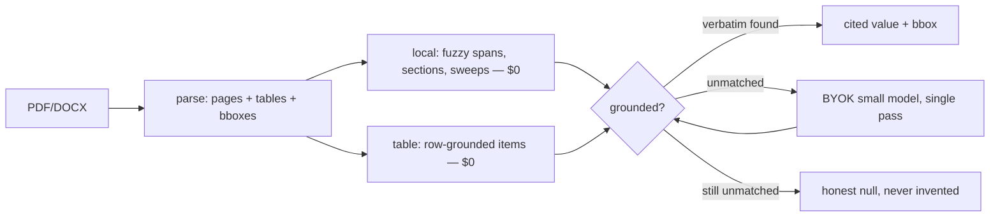

# qleric — grounded extraction at $0.001/doc

[](LICENSE)


Every extracted value ships with its **verbatim quote + page + bbox**, or it doesn't ship. The research bet: a small model + ruthless local machinery beats a big model + hope — at 1/100th the cost.

## The pipeline



Four strategies per field, declared in the pack — not chosen at runtime:

| strategy | cost | what it does |
|---|---|---|
| `local` | $0 | fuzzy anchor search → span → normalize → ground. Dates, totals, sections, law. |
| `table` | $0 | header match → rows as items with per-cell bboxes. Line items. |
| `pii` | $0 | full-doc sweep, all occurrences + `bboxes`. Emails, phones, SSNs, cards, IBANs. |
| `llm` | metered | single pass for what can't be named: sellers, skills, clauses. Verified locally, same gate. |

No value bypasses grounding. `grounded: false` means flagged, never silently trusted.

## 30 seconds

```bash
pip install -r requirements.txt
python api.py
curl -X POST -F "file=@invoice.pdf" -F "pack=invoice" http://localhost:5000/analyze
```

```json
{
  "fields": {
    "total_amount": {
      "value": "$1,240.00", "verbatim": "Total Due $1,240.00",
      "page_number": 1, "bbox": [[x0, y0, x1, y1]],
      "grounded": true, "source": "local"
    }
  },
  "meta": {"format": "PDF", "pages": 1, "grounding_rate": "4/8",
           "cost": {"calls": 0, "cost_usd": 0.0}}
}
```

`-F "pack=resume|pii|contract"`, `-F "deep=true"` (LLM over all unmatched), `-F "annotate=true"` (highlighted PDF).

Python: `from qleric import parse, query; query(parse(data, "pdf"), INVOICE_FIELDS)`.

## How intelligence works (hybrid, BYOK)

| mode | key | use |
|---|---|---|
| **Offline** (default) | none | parse, local spans, tables, highlights, MCP tools |
| **BYOK** | `API_KEY` + `MODEL` (+ `BASE_URL`) | any OpenAI-compatible endpoint — Claude, OpenAI, Gemini, Ollama. Single pass, locally verified. |
| **MCP** | none in our process | `python -m qleric.mcp`: `read_pages`, `find_quote`, `annotate` — your assistant reasons, our core grounds. |

No hosted key, no vendor SDK. Keys never logged, `.env` gitignored.

## Measured cost (not marketed)

Every LLM call is metered into `meta.cost`. Small models are the point: constrain intelligence, force better machinery.

| run | calls | tokens in/out | cost |
|---|---|---|---|
| 8 CUAD contracts, gpt-6-luna | 8 | 59,703 / 2,210 | **$0.0103 (~$0.0013/doc)** |
| 127 mixed requests, gpt-6-luna | 127 | ~50k / ~19k | **~$0.01** |
| 90-case corpus, keyless | 0 | 0 / 0 | **$0** |

## Evals: how we know it works

Seeded synthetic corpus (`evals/generate.py`, deterministic) + private real-doc validation (your docs never leave your machine):

| suite | what | local accuracy | grounding |
|---|---|---|---|
| 90 synthetic (30 invoice / 30 resume / 30 PII) | mess axes: label variants, EU/US dates, case noise, junk, 2-page, overlap traps | **100%** every offline field | 0 false grounds |
| CUAD contracts (510-clause public truth) | SEC filings: paragraph-embedded dates, `Province of` law, filing-header decoys | agreement 62%, law 38% (inferred dates correctly nulled → LLM territory) | 0 false grounds |
| your docs (`python -m evals.validate_real`) | hand-checked truth on your own PDFs | real CVs: 100% offline | template keeps the loop honest |

Failure loop: every miss → new mess axis in the generator or new anchor/member pattern. The corpus grows; the machinery hardens; docs stay private.

## Repo map

- `qleric/` — core: `documents` (parse), `grounding` (prove it), `local` (spans), `highlight` (bboxes), `lm` (BYOK), `costs` (ledger), `mcp` (tools)
- `qleric/packs/` — `invoice`, `resume`, `pii`, `contract`
- `evals/` — `generate.py`, `eval.py`, `validate_real.py`, `validate_cuad.py`, `real_truth.py` (your template)
- `api.py` — stateless Flask; `samples/` — synthetic corpus + table proof
