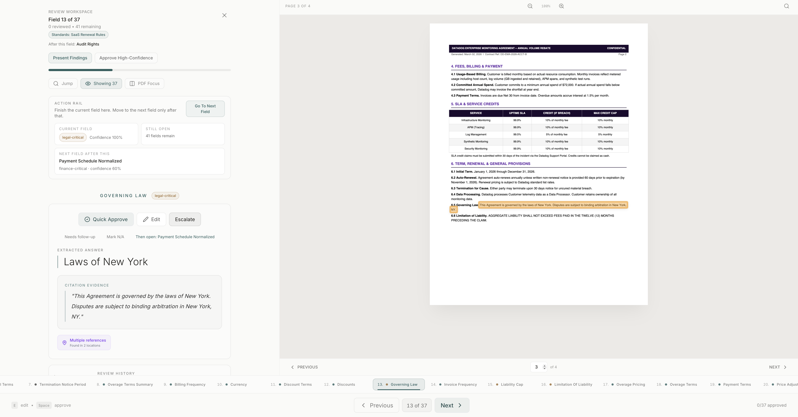
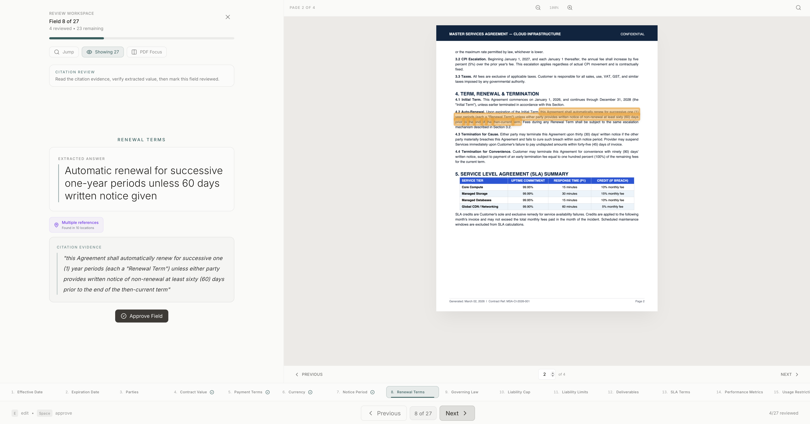
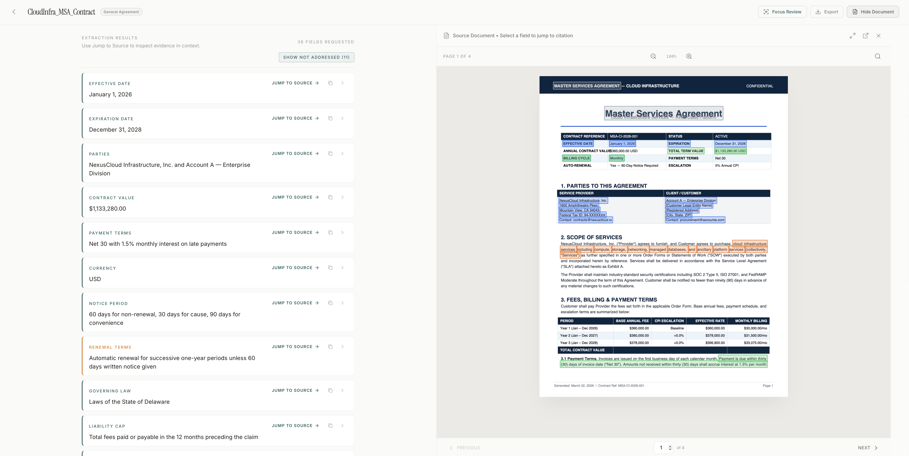

# Document Extractor


A production-grade utility for extracting structured data from PDF and DOCX documents. Built-in hallucination verification, structural derivation, and multi-format support. Designed to drop into a production environment in under five minutes.







---

## Deployment options

### 01 — Direct Python integration

For CLI tools, document batch processors, or internal data science pipelines.

```bash
pip install pymupdf python-docx anthropic msgspec spacy
python -m spacy download en_core_web_sm
```

```python
from contract_extractor import ContractExtractor

extractor = ContractExtractor()

with open("contract.pdf", "rb") as f:
    result = extractor.extract_from_file(f.read(), extension="pdf")

print(result["metadata"]["knowledge_graph"])
```

### 02 — Microservice deployment

Deploy as a stateless extraction microservice. A `simple_api.py` is included for rapid rollout.

```bash
python simple_api.py
```

```bash
curl -X POST -F "file=@legal_agreement.docx" http://localhost:5000/analyze
```

### 03 — Enterprise intelligence layer

Use the knowledge graph and verification logic to build custom dashboards: risk dashboards triggered by null-derived risks, visual timelines mapping obligations to a Gantt chart, or clickable audit viewers using `reference_snippet` and `bbox` coordinates.

---

## Core intelligence layers

**Bias detection** — Identifies clause bias (buyer/seller favorability) using field facets.

**Verification logic** — Python-level grounding verification for every extracted quote. Hallucination guard for all outputs.

**Object derivation engine** — Automatically converts flat keys into rights, obligations, and risks.

**Multi-format structural intelligence** — Treats DOCX headings as virtual pages for consistent downstream processing.

---

## Setup

1. Add your `ANTHROPIC_API_KEY` to a `.env` file.
2. Python 3.9+ recommended.
3. Documents are processed via Anthropic's API. Ensure your use case complies with your data sovereignty requirements.

---

## License

Licensed under the [GNU Affero General Public License v3.0](https://www.gnu.org/licenses/agpl-3.0.en.html).

This core engine is open source to drive adoption of verified document intelligence. Making the grounding and derivation logic public is an effort to eliminate black-box extraction in document processing.

[qleric.com](https://qleric.com)
