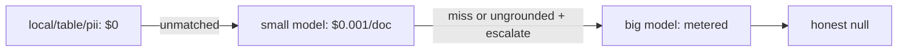
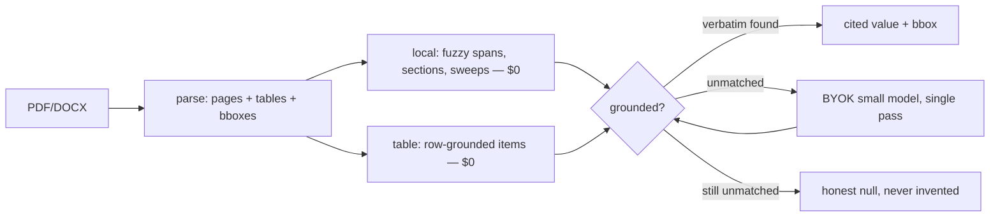

# qleric

Grounded document extraction. Every value ships with its **verbatim quote + page + bbox** — or it doesn't ship.


*Output of `-F "annotate=true"`: every cited value highlighted. Table rows cited per-cell.*

## Why a small model

Local machinery resolves everything nameable for $0; the model only sees the residue (sellers, skills, clauses). A small model exposes gaps instead of papering over them — each gap becomes a deterministic fix.

- Measured: gpt-6-luna seller/name/title/skills 97–100% on real CVs, all grounded, ~$0.0013/doc.
- Limits: inferred dates ("end of calendar year" → 12/31) need judgment; 200-page SEC nuance exceeds small-model discipline. `deep=true` or a bigger model covers it; the ledger prices it exactly.
- Rule: never upgrade the model to fix what an anchor can fix. Eval fails first, machinery second, model last.

## Delegation: local → small → big

Three tiers, cheapest first. Each tier only sees what the previous couldn't cite:



- **Local** resolves everything nameable (dates, totals, sections, sweeps, rows).
- **Small** (`MODEL`, default gpt-6-luna) takes the residue: sellers, skills, clauses. Single pass.
- **Big** (`MODEL_BIG`, unset by default) fires only on fields flagged `"escalate": true` that come back missed or ungrounded. Contract clauses carry the flag; invoice/resume don't need it.
- Every tier answers to the same grounding gate, and `meta.cost` itemizes each call by model.



Four strategies per field, declared in the pack — not chosen at runtime:

| strategy | cost | what it does |
|---|---|---|
| `local` | $0 | fuzzy anchor search → span → normalize → ground. Dates, totals, sections, law. |
| `table` | $0 | header match → rows as items with per-cell bboxes. Line items. |
| `pii` | $0 | full-doc sweep, all occurrences + `bboxes`. Emails, phones, SSNs, cards, IBANs. |
| `llm` | metered | single pass for what can't be named: sellers, skills, clauses. Verified locally, same gate. |

No value bypasses grounding. `grounded: false` means flagged, never silently trusted.

## 30 seconds

```bash
pip install -r requirements.txt
python api.py
curl -X POST -F "file=@invoice.pdf" -F "pack=invoice" http://localhost:5000/analyze
```

```json
{
  "fields": {
    "total_amount": {
      "value": "$1,240.00", "verbatim": "Total Due $1,240.00",
      "page_number": 1, "bbox": [[x0, y0, x1, y1]],
      "grounded": true, "source": "local"
    }
  },
  "meta": {"format": "PDF", "pages": 1, "grounding_rate": "4/8",
           "cost": {"calls": 1, "prompt_tokens": 1436,
                    "completion_tokens": 179, "cost_usd": 0.000323}}
}
```

Works with no keys: LLM fields return `value: null` + `note: "No API key..."`.
Copy `example.env` → `.env` and add `API_KEY` to enable them. No hosted key, no signup.

`-F "pack=resume|pii|contract"`, `-F "deep=true"` (LLM over all unmatched), `-F "annotate=true"` (highlighted PDF).

> `api.py` is a dev server. For anything networked: `gunicorn api:app` behind auth + reverse proxy — it spends your LLM key per request.
Python: `from qleric import parse, query; query(parse(data, "pdf"), INVOICE_FIELDS)`.

## How intelligence works (hybrid, BYOK)

| mode | key | use |
|---|---|---|
| **Offline** (default) | none | parse, local spans, tables, highlights, MCP tools |
| **BYOK** | `API_KEY` + `MODEL` (+ `BASE_URL`) | any OpenAI-compatible endpoint — Claude, OpenAI, Gemini, Ollama. Single pass, locally verified. |
| **MCP** (experimental) | none in our process | `python -m qleric.mcp`: `read_pages`, `find_quote`, `annotate` — stdio smoke-tested, no real client yet. Your assistant reasons, our core grounds. |

No hosted key, no vendor SDK. Keys never logged, `.env` gitignored.

## Cost

`meta.cost` on every response: calls, tokens in/out, USD. Keyless runs are $0 by construction (no LLM called).

| run | calls | tokens in/out | cost |
|---|---|---|---|
| 8 CUAD contracts, gpt-6-luna | 8 | 59,703 / 2,210 | $0.0103 |
| 127 mixed requests, gpt-6-luna | 127 | ~50k / ~19k | ~$0.01 |
| 90-case corpus, keyless | 0 | 0 / 0 | $0 |
| 5 CUAD escalation (luna → sol) | 10 | 69,709 / 7,195 | $0.0851 — 13× small-only, 0 additional closes |

The escalation row is the point: a bigger model on the same context closes nothing. Next work is retrieval, not reasoning — see below.

## Evals

Seeded synthetic corpus (`evals/generate.py`) + private real-doc validation:

| suite | result |
|---|---|
| 90 synthetic (invoice / resume / PII) | 100% offline fields, 0 false grounds |
| CUAD contracts (public clause truth) | agreement 62%, law 38%; inferred dates nulled (LLM territory) |
| your docs (`python -m evals.validate_real`) | real CVs: 100% offline |

Misses feed back into the generator or pack anchors. No false grounds recorded to date.

## Repo map

- `qleric/` — core: `documents` (parse), `grounding` (prove it), `local` (spans), `highlight` (bboxes), `lm` (BYOK), `costs` (ledger), `mcp` (tools)
- `qleric/packs/` — `invoice`, `resume`, `pii`, `contract`
- `evals/` — `generate.py`, `eval.py`, `validate_real.py`, `validate_cuad.py`, `real_truth.py` (your template)
- `api.py` — stateless Flask; `samples/` — synthetic corpus + table proof
