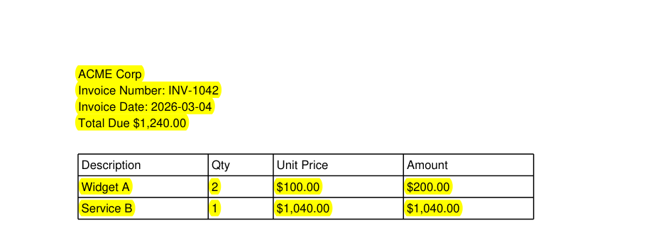
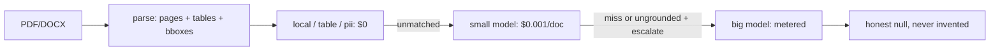

# qleric

Grounded document extraction. Every value ships with its **verbatim quote + page + bbox** — or it doesn't ship.


*Output of `-F "annotate=true"`: every cited value highlighted. Table rows cited per-cell.*

## Why a small model

Local machinery resolves everything nameable for $0; the model only sees the residue (sellers, skills, clauses). A small model exposes gaps instead of papering over them — each gap becomes a deterministic fix.

- Measured: gpt-6-luna seller/name/title/skills 97–100% on real CVs, all grounded, ~$0.0013/doc.
- Limits: inferred dates ("end of calendar year" → 12/31) need judgment; 200-page SEC nuance exceeds small-model discipline. `deep=true` or a bigger model covers it; the ledger prices it exactly.
- Rule: never upgrade the model to fix what an anchor can fix. Eval fails first, machinery second, model last.

## Delegation: local → small → big

Three tiers, cheapest first. Each tier only sees what the previous couldn't cite:



- **Local** (`local`, `table`, `pii` sources) resolves everything nameable: dates, totals, sections, sweeps, rows. $0.
- **Small** (`MODEL`, default gpt-6-luna; `source: llm-small`) takes the residue: sellers, skills, clauses. Single targeted pass.
- **Big** (`MODEL_BIG`, unset by default; `source: llm-big`) fires only on fields flagged `"escalate": true` that come back missed or ungrounded.
- `deep=true` widens the small pass to all unmatched fields; it does not trigger big-tier (big needs `escalate` + a miss regardless).
- Every tier answers to the same grounding gate, and `meta.cost` itemizes each call by model.

Four strategies per field, declared in the pack — not chosen at runtime:

| strategy | cost | `source` values | what it does |
|---|---|---|---|
| `local` | $0 | `local` | fuzzy anchor search → span → normalize → ground. Dates, totals, sections, law. |
| `table` | $0 | `table` | header match → rows as items with per-cell bboxes. Line items. |
| `pii` | $0 | `pii` | full-doc sweep, all occurrences + `bboxes`. Emails, phones, SSNs, cards, IBANs. |
| `llm` | metered | `llm-small`, `llm-big` | single pass for what can't be named: sellers, skills, clauses. Verified locally, same gate. |

No value bypasses grounding. `grounded: false` means flagged, never silently trusted.

## 30 seconds

```bash
pip install -r requirements.txt
python api.py
curl -X POST -F "file=@invoice.pdf" -F "pack=invoice" http://localhost:5000/analyze
```

Or the CLI (same core, no server):

```bash
pip install -e .               # exposes the `qleric` command
qleric invoice.pdf --pack invoice
qleric resume.pdf --pack resume --deep --annotate -o out.json
qleric --smoke                  # import every module + keyless query per pack
```

Docker: `docker build -t qleric . && docker run -p 5000:5000 -e API_KEY=... qleric`

```json
{
  "fields": {
    "total_amount": {
      "value": "$1,240.00", "verbatim": "Total Due $1,240.00",
      "page_number": 1, "bbox": [[x0, y0, x1, y1]],
      "grounded": true, "source": "local"
    }
  },
  "meta": {"format": "PDF", "pages": 1, "grounding_rate": "4/8",
           "cost": {"calls": 1, "prompt_tokens": 1436,
                    "completion_tokens": 179, "cost_usd": 0.000323},
           "retrieval": {"budget": 12000, "chars": 1436, "fallback": false,
                         "fields": {"seller": {"keys": 2, "windows": 1, "sent": 1}}}}
```

Works with no keys: LLM fields return `value: null` + `note: "No API key..."`.
Copy `example.env` → `.env` and add `API_KEY` to enable them. No hosted key, no signup.

`-F "pack=resume|pii|contract"`, `-F "deep=true"` (LLM over all unmatched — small pass only; local sections that miss stay missed, big tier still needs `escalate` + a miss), `-F "annotate=true"` (highlighted PDF).

> `api.py` is a dev server. For anything networked: `gunicorn api:app` behind auth + reverse proxy — it spends your LLM key per request.
Python: `from qleric import parse, query; query(parse(data, "pdf"), INVOICE_FIELDS)`.

## How intelligence works (hybrid, BYOK)

| mode | key | use |
|---|---|---|
| **Offline** (default) | none | parse, local spans, tables, highlights, MCP tools |
| **BYOK** | `API_KEY` + `MODEL` (+ `BASE_URL`) | any OpenAI-compatible endpoint — Claude, OpenAI, Gemini, Ollama. Single pass, locally verified. |
| **MCP** (experimental) | none in our process | `python -m qleric.mcp`: `read_pages`, `find_quote`, `annotate` — stdio smoke-tested, no real client yet. Your assistant reasons, our core grounds. |

No hosted key, no vendor SDK. Keys never logged, `.env` gitignored.

## Cost

`meta.cost` on every response: calls, tokens in/out, USD. Keyless runs are $0 by construction (no LLM called).

| run | calls | tokens in/out | cost |
|---|---|---|---|
| 8 CUAD, luna-only (Nov 12) | 8 | 59,703 / 2,210 | $0.0103 |
| 127 mixed, luna-only (Nov 11, pre-retrieval baseline) | 127 | ~50k / ~19k | ~$0.01 |
| 90-case corpus, keyless (all runs) | 0 | 0 / 0 | $0 |
| 5 CUAD escalation, sparse ctx (Nov 12) | 10 | 69,709 / 7,195 | $0.0851 — 0 additional closes |
| 8 CUAD escalation, dense retrieval (Nov 13) | 16 | 37,854 / 7,566 | $0.0634 — termination 62→88%, non-compete →100% |
The two escalation rows are the thesis in numbers: a big model on a raw dump closes nothing; the same model on dense retrieval converts. Retrieval, not reasoning.

## Evals

Seeded synthetic corpus (`evals/generate.py`) + private real-doc validation:

| suite | result |
|---|---|
| 90 synthetic (invoice / resume / PII) | 100% offline fields, 0 false grounds. Axes: label variants, EU/US dates, case noise, junk, 2-page, overlap traps, **filing-header decoys, paragraph-embedded values** |
| CUAD contracts (public clause truth) | agreement 62%, renewal 80%, exclusivity 100%, MFN 88%; inferred dates nulled. Yes/No flags grade correct nulls as hits |
| your docs (`python -m evals.validate_real`) | real CVs: 100% offline |

Misses feed back into the generator or pack anchors. No false grounds recorded to date.

## Retrieval is the product

`meta.retrieval` on every response: windows hit/sent per field, chars, fallback flag. Tune with `python3 evals/retrieve.py <doc> <pack> <field>` — ranked windows, visual iteration on `retrieve` keywords. Small model + dense context beats big model + dump (13× cost, 0 closes — see Cost).

## Repo map

- `qleric/` — core: `documents` (parse), `grounding` (prove it), `local` (spans), `highlight` (bboxes), `lm` (BYOK), `costs` (ledger), `mcp` (tools)
- `qleric/packs/` — `invoice`, `resume`, `pii`, `contract`
- `evals/` — `generate.py`, `eval.py`, `validate_real.py`, `validate_cuad.py`, `real_truth.py` (your template)
- `api.py` — stateless Flask; `samples/golden/` — hand-checked demo docs; `samples/corpus/` — 90-case synthetic eval set (`real/` is gitignored private docs)
